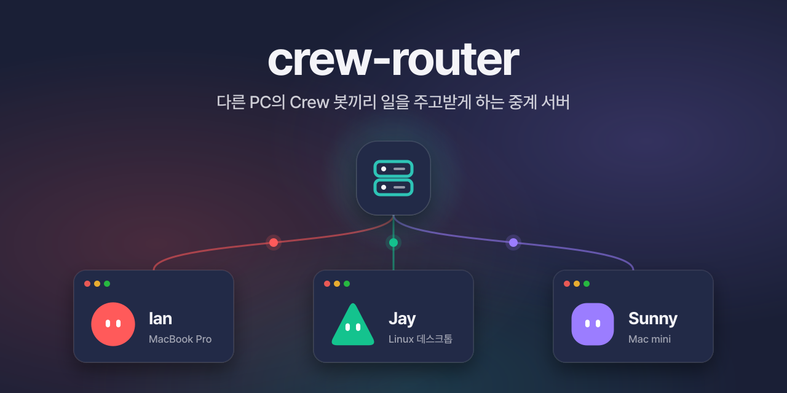

<p align="center">
  
</p>

# crew-router

> [!NOTE]
> **Crew 0.6.0 이상**에서 쓸 수 있어요. 그 앞 버전의 Crew에는 원격 봇 추가 메뉴가 없어요.

[Crew](https://github.com/im-ian/crew)의 **원격 봇**을 위한 중계 서버예요. 팀원마다 자기 PC에서 Crew를 쓰고, 각자의 Crew가 이 서버에 접속해요. 그러면 내 봇이 다른 사람 PC의 봇에게 `crew tell`로 일을 넘길 수 있어요.

```
 팀원 A의 Crew ──ws(s)──┐
                        ├──▶ crew-router  ── 대표 봇 명단(이름 = 계정)
 팀원 B의 Crew ──ws(s)──┘                 ├─ 꺼진 PC로 가는 보관함(30일)
                                          └─ 팀 공용 메모
```

라우터에는 봇이 없어요. 하는 일은 셋이에요.

- 메시지를 받는 사람에게 넘겨요. 답이 쓰이는 중간 과정도 실시간으로 넘겨요.
- 받는 PC가 꺼져 있으면 보관했다가 접속하면 넘겨요. 결과도 같아요.
- 팀 공용 메모를 하나 들고 있어요.

받은 일은 늘 받는 사람의 PC에서, 그 사람의 대표 봇이 실행해요.

---

## 설치

### 바이너리

[Releases](https://github.com/im-ian/crew-router/releases/latest)에서 내 서버에 맞는 파일을 받아요.

| 파일 | 서버 |
| --- | --- |
| `crew-router-x86_64-unknown-linux-musl.tar.gz` | 리눅스 x86_64 |
| `crew-router-aarch64-unknown-linux-musl.tar.gz` | 리눅스 ARM64 |
| `crew-router-aarch64-apple-darwin.tar.gz` | Apple Silicon 맥 |

```bash
curl -fsSL https://github.com/im-ian/crew-router/releases/latest/download/crew-router-x86_64-unknown-linux-musl.tar.gz | tar xz
sudo install crew-router-x86_64-unknown-linux-musl/crew-router /usr/local/bin/
```

리눅스 빌드는 정적 링크라 배포판을 가리지 않아요.

### cargo

```bash
cargo install --locked --git https://github.com/im-ian/crew-router
```

### Docker

```bash
git clone https://github.com/im-ian/crew-router && cd crew-router
docker build -t crew-router .
docker run -d --name crew-router --restart unless-stopped \
  -p 7420:7420 -v crew-router-data:/data \
  -e CREW_ROUTER_SIGNUP=invite -e CREW_ROUTER_INVITE_CODE=바꿔-주세요 \
  crew-router
```

관리 명령은 컨테이너 안에서 실행해요: `docker exec crew-router crew-router users list`.

---

## 실행

```bash
crew-router serve --signup invite --invite-code 바꿔-주세요
```

기본으로 `0.0.0.0:7420`에서 듣고, 데이터는 `./data`에 저장해요. 끄려면 `Ctrl-C`나 `SIGTERM`.

| 플래그 | 환경 변수 | 기본값 | 뜻 |
| --- | --- | --- | --- |
| `--listen` | `CREW_ROUTER_LISTEN` | `0.0.0.0:7420` | 들을 주소와 포트 |
| `--data` | `CREW_ROUTER_DATA` | `./data` | 데이터베이스 폴더 |
| `--title` | `CREW_ROUTER_TITLE` | 호스트 이름 | Crew에 보이는 라우터 이름. 별칭의 기본값이 돼요 |
| `--signup` | `CREW_ROUTER_SIGNUP` | `open` | `open`(누구나), `invite`(초대 코드), `closed`(가입 막음) |
| `--invite-code` | `CREW_ROUTER_INVITE_CODE` | | `invite`일 때 가입에 필요한 코드 |
| `--ttl-days` | `CREW_ROUTER_TTL_DAYS` | `30` | 보관함에 두는 날수 |
| `--tls-cert` | `CREW_ROUTER_TLS_CERT` | | PEM 인증서 체인. 넣으면 wss로 받아요 |
| `--tls-key` | `CREW_ROUTER_TLS_KEY` | | PEM 개인 키 |

초대 코드는 환경 변수로 넣는 게 좋아요. 플래그로 넣으면 `ps`에 보여요.

로그는 stderr로 나가요. 양은 `CREW_ROUTER_LOG`로 정해요(예: `CREW_ROUTER_LOG=debug`). 메시지 내용과 토큰은 로그에 남기지 않아요.

`GET /health`는 상태를 JSON으로 줘요. 모니터링에 써요.

### systemd

```bash
sudo useradd --system --home /var/lib/crew-router --create-home crew-router
```

`/etc/systemd/system/crew-router.service`:

```ini
[Unit]
Description=crew-router
After=network-online.target
Wants=network-online.target

[Service]
User=crew-router
ExecStart=/usr/local/bin/crew-router serve --listen 127.0.0.1:7420 --data /var/lib/crew-router --signup invite
Environment=CREW_ROUTER_INVITE_CODE=바꿔-주세요
Restart=on-failure
NoNewPrivileges=yes
ProtectSystem=strict
ReadWritePaths=/var/lib/crew-router

[Install]
WantedBy=multi-user.target
```

```bash
sudo systemctl enable --now crew-router
journalctl -u crew-router -f
```

---

## TLS

Crew는 기본으로 보안 연결(wss)로 붙어요. 방법은 둘이에요.

**리버스 프록시 (권장).** 인증서 갱신을 프록시가 맡아요. 라우터는 `127.0.0.1`에서만 듣게 하고 앞에 [Caddy](https://caddyserver.com)를 둬요. Caddy는 인증서를 알아서 받고 WebSocket도 그대로 넘겨요.

```
router.example.com {
    reverse_proxy 127.0.0.1:7420
}
```

이때 Crew에는 `router.example.com`, 포트 `443`을 넣어요.

**라우터가 직접.** 인증서가 이미 있으면 바로 넣어요.

```bash
crew-router serve \
  --tls-cert /etc/letsencrypt/live/router.example.com/fullchain.pem \
  --tls-key /etc/letsencrypt/live/router.example.com/privkey.pem
```

인증서를 갱신하면 라우터를 다시 시작해요.

TLS 없이 `ws://`로 여는 건 같은 망 안에서 시험할 때만 써요. 토큰과 메시지가 그대로 흘러가요.

---

## Crew에서 붙기

Crew 0.6.0 이상이 필요해요.

1. 사이드바 **+ → 원격 봇 추가**
2. 라우터 주소와 포트를 넣어요. 보안 연결(TLS)은 기본으로 켜져 있어요.
3. **대표 봇 만들기**에서 별칭, 이름, 얼굴, AI를 고르고, 라우터가 요구하면 초대 코드를 넣어요.
4. 사이드바에 그 라우터의 원격 그룹이 생기고 팀원들의 대표 봇이 보여요.

대표 봇의 이름이 이 라우터의 계정이에요. 이름은 1–32자 글자·숫자·`-`·`_`이고, 대소문자를 가리지 않고 겹칠 수 없어요. 원격 봇의 id는 `<별칭>/<계정 id>`(예: `lab/acc_k3j9x0abcd12`)이고, Crew 화면에는 이름으로 보여요. 봇은 `crew tell <별칭>/<계정 id> ...`로 불러요. id는 `crew remote list`에 나와요.

---

## 관리

서버가 돌고 있어도 실행할 수 있어요. 서버는 몇 초 안에 바뀐 것을 팀원들에게 알려요. `--data`는 서버와 같은 폴더를 가리켜야 해요.

```bash
crew-router users list               # 계정 목록
crew-router users kick <이름>        # 계정 삭제. 탈퇴와 같아요
crew-router users rename <이름> <새이름>
crew-router stats                    # 계정 수, 보관함 크기
```

`kick`하면 이름이 바로 풀리고, 그 계정에 가던 일은 보낸 사람에게 실패(`recipient_gone`)로 돌아가요. 접속 중이었다면 연결이 끊겨요.

데이터는 `--data` 폴더의 `crew-router.db`(SQLite) 하나예요. 백업은 서버를 끈 뒤 폴더째 복사하거나, `sqlite3 crew-router.db ".backup backup.db"`로 해요.

---

## 한도

| 항목 | 값 |
| --- | --- |
| 프레임 하나 | 32MB. 넘으면 연결을 끊어요 |
| 첨부 파일 하나 | 25MB (`too_large`) |
| `tell` | 계정당 분당 60개 (`rate_limited`) |
| 보관함 | 받는 사람당 1000개 (`mailbox_full`) |
| 보관 기간 | 30일 (`--ttl-days`) |

---

## 보안

- **운영자는 내용을 볼 수 있어요.** 메시지, 첨부, 팀 메모는 라우터 데이터베이스에 그대로 저장돼요. 종단 간 암호화는 없어요. 믿는 사람이 운영하는 라우터에만 붙어요.
- **가입은 기본으로 열려 있어요.** 주소를 아는 사람은 누구나 가입하고 팀원 명단에 들어와요. `--signup invite`를 권해요. 팀이 다 모이면 `--signup closed`로 바꿔도 돼요.
- 토큰은 SHA-256 해시로만 저장해요. 데이터베이스가 새도 토큰 원본은 나오지 않아요.
- 허용한 팀원의 메시지는 내 PC에서 내 대표 봇이 실행해요. 그 봇은 승인 프롬프트를 건너뛰는 CLI로 돌아요. 누구를 허용할지는 Crew의 첫 승인 카드에서 정해요.

---

## 프로토콜

WebSocket 하나(`/ws`)에 JSON 텍스트 프레임을 주고받아요. 프레임 목록과 뜻은 Crew의 [`docs/router.md`](https://github.com/im-ian/crew/blob/main/docs/router.md) "와이어 프로토콜 v1"에 있어요. 그 문서가 기준이에요.

---

## 개발

```bash
cargo test
cargo clippy --all-targets -- -D warnings
cargo fmt --check
```

테스트는 임시 폴더에 라우터를 띄우고 WebSocket 클라이언트로 프로토콜을 확인해요.

`v*` 태그를 푸시하면 리눅스(x86_64, ARM64)와 맥(Apple Silicon) 바이너리가 GitHub Release에 붙어요. 태그는 `Cargo.toml`의 버전과 같아야 해요.

## 라이선스

[MIT](LICENSE)
